  

  <a href="https://anurag-dubey.vercel.app"><b>PORTFOLIO</b></a>
  &nbsp;&nbsp;·&nbsp;&nbsp;
  <a href="https://github.com/roarscarch"><b>GITHUB</b></a>
  &nbsp;&nbsp;·&nbsp;&nbsp;
  <a href="mailto:2020ugee082@nitjsr.ac.in"><b>EMAIL</b></a>

## 01 — MANIFESTO

> **I build the part you never notice — until it fails. Then I build it so it doesn't.**

Backend engineering is the discipline of making complexity feel inevitable. I design systems where data has a clear path, failures have a clear owner, and an LLM is never the only thing standing between a user and a correct answer.

I care about the boring parts: idempotency, backpressure, retries, traces, and interfaces that don't leak. That is usually where *"it works on my machine"* goes to die.

### Operating principles

- **Model the domain before the database.** Schemas are contracts. Get them right and the code gets simple.
- **Make it observable or it isn't done.** If I can't see it, I can't trust it under load.
- **Automate the second time.** A manual step repeated twice is a bug with better PR.
- **Give agents guardrails, not vibes.** Retrieval quality, evals and fallbacks beat prompt poetry.

## 02 — REFERENCE ARCHITECTURE

A shape I keep coming back to: thin edge, explicit contracts, an event spine for decoupling, and retrieval as a first-class service.

## 03 — SELECTED SYSTEMS

*Six systems, chosen for the problem — not the star count.*

  
  
  
  
  
  

Project index — text version

- **Agentic Pod** · Kubernetes-native autonomous diagnostic agent built on a LangGraph ReAct loop. `Kubernetes` `LangGraph` `Python`
- **Agentic RAG** · Production-grade ingestion and retrieval pipeline with multi-step reasoning and tracing. `Vector DB` `FastAPI` `LangSmith`
- **Kafka Food Delivery** · Event-driven delivery backbone designed for scale, resilience and decoupling. `Kafka` `Java` `Redis`
- **termtree** · ASCII-art git branch visualizer that turns tangled history into an instant mental model. `Rust` `CLI`
- **repograph** · Interactive graph of commit history and authorship. `TypeScript` `D3` `Node`
- **Diffusion Music Box** · Endless evolving ambient music from a tiny diffusion model on spectrograms. `Python` `PyTorch` `Audio`

## 04 — TELEMETRY

  

A year of commits, reviews, refactors and the occasional 2 a.m. revelation. This card refreshes itself every night.

## 05 — SIGNAL

If you are building something ambitious — agentic systems, infrastructure that has to stay up, or a problem with no clean answer — I want to hear about it.

  <a href="mailto:2020ugee082@nitjsr.ac.in"><b>EMAIL</b></a>
  &nbsp;&nbsp;·&nbsp;&nbsp;
  <a href="https://anurag-dubey.vercel.app"><b>PORTFOLIO</b></a>
  &nbsp;&nbsp;·&nbsp;&nbsp;
  <a href="https://github.com/roarscarch"><b>GITHUB</b></a>

  

